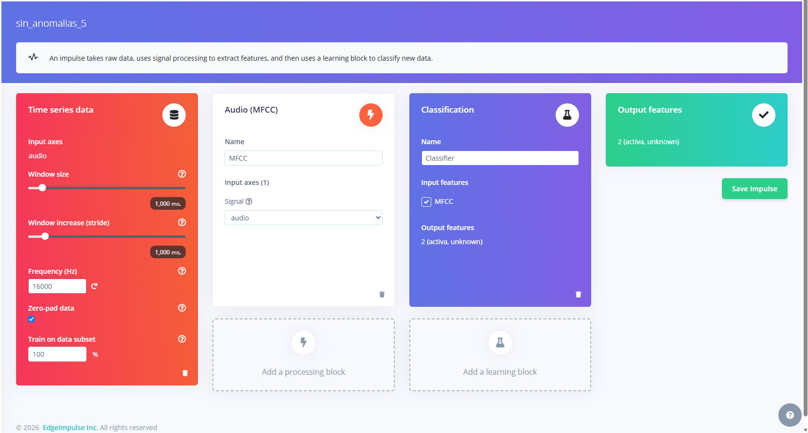
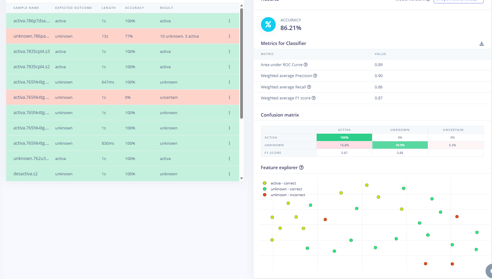

# 🎙️ Real-Time Keyword Spotting ("ACTIVA") using TinyML & Edge Impulse

[](https://docs.arduino.cc/hardware/nano-33-ble-sense)
[](https://edgeimpulse.com/)
[](https://isocpp.org/)
[](https://eina.unizar.es/)

## 🎓 Academic Context

- **Institution:** School of Engineering and Architecture (**EINA**) — **University of Zaragoza (UNIZAR)**
- **Program:** Master's Degree in Electronic Engineering (*Máster Universitario en Ingeniería Electrónica*)
- **Course:** Smart Sensors (*Sensores Inteligentes*) — Lab Practice 1

---

## 📋 Table of Contents

1. [Project Overview](#-project-overview)
2. [Hardware & Audio Acquisition Setup](#-hardware--audio-acquisition-setup)
3. [Voice Command-to-LED Mapping](#-voice-command-to-led-mapping)
4. [Edge Impulse Pipeline & Audio DSP Analysis](#-edge-impulse-pipeline--audio-dsp-analysis)
   - [Why Spectral Feature Extraction (MFCC / MFE) Outperforms Raw Audio](#-why-spectral-feature-extraction-mfcc--mfe-outperforms-raw-audio)
5. [Dataset & Model Performance](#-dataset--model-performance)
6. [Embedded Firmware Architecture](#-embedded-firmware-architecture)
7. [Repository Structure & Deployment](#-repository-structure--deployment)

---

## 🎯 Project Overview

This project implements a real-time **TinyML** Keyword Spotting (**KWS**) system deployed on an **Arduino Nano 33 BLE Sense** microcontroller, capable of recognizing the spoken Spanish wake-word **`"activa"`** directly on-device without cloud connectivity.

Audio is captured at `16 kHz` via the onboard digital **PDM microphone**, converted into time-frequency spectrograms using **Edge Impulse**, and evaluated continuously using a sliding-window neural network classifier. Upon detecting the target keyword above the confidence threshold, the board provides immediate visual feedback by illuminating its onboard LED for `2,000 ms`.

---

## 🔧 Hardware & Audio Acquisition Setup

- **Microcontroller:** Arduino Nano 33 BLE Sense (nRF52840 ARM Cortex-M4F @ 64 MHz, 256 KB SRAM)
- **Acoustic Sensor:** Onboard omnidirectional digital MEMS microphone (**MP34DT05**) interfaced via Pulse Density Modulation (`PDM.h` library)
- **Actuator:** Onboard LED (`LED_BUILTIN` on pin `D13`, active-high)

| Audio Parameter | Configuration | Purpose |
| :--- | :--- | :--- |
| **Sampling Rate** | `16,000 Hz` (16 kHz) | Captures full human speech spectral band (up to 8 kHz Nyquist limit) |
| **Bit Depth / Channels** | 16-bit PCM, Mono (1 ch) | Standard speech format compatible with Edge Impulse DSP blocks |
| **PDM Buffer Size** | `2,048 bytes` | Prevents DMA/interrupt buffer overruns during continuous capture |
| **Microphone Gain** | `50` (range `0–80`) | Balances speech sensitivity while avoiding acoustic clipping |

---

## 💡 Voice Command-to-LED Mapping

The classifier evaluates incoming 1-second acoustic frames across the trained audio classes (`activa` and `unknown` / background noise). When the predicted probability for `activa` exceeds the configured confidence threshold, a non-blocking timer holds `LED_BUILTIN` active for `2 seconds`.

| Edge Impulse Label | Acoustic Event | Confidence Condition | `LED_BUILTIN` State | Behavior |
| :--- | :--- | :---: | :---: | :--- |
| `activa` | Target wake-word spoken | `> 0.90` (`90%`) | 🟠 **ON (`HIGH`)** | Latches ON for `2,000 ms` (non-blocking) |
| `unknown` | Background noise, silence, or other speech | Any | ⚫ **OFF (`LOW`)** | Remains OFF (or turns OFF once timer expires) |

---

## 🧠 Edge Impulse Pipeline & Audio DSP Analysis

### Impulse Architecture

The Edge Impulse pipeline (`mloren-project-1_inferencing`) processes 1-second audio windows extracted from continuous 16 kHz PCM streams:

<p align="center">
  
</p>

- **Time Series Audio Input:**
  - **Window Size:** `1,000 ms` (`16,000` raw 16-bit samples at `16 kHz`)
  - **Window Increase (Stride):** `250 ms` (`4,000` samples — 4 inferences/second in firmware)
  - **Zero-pad Data:** Enabled for clips shorter than `1,000 ms`
- **Processing Block:** **MFCC / MFE** (Mel-Frequency Cepstral Coefficients / Mel-Filterbank Energies) converting the 1D waveform into a compact 2D time-frequency spectrogram.
- **Learning Block:** **Classification (1D Convolutional / Dense Neural Network)** quantized to **Int8** for low-latency Cortex-M4F execution.

### 🔬 Why Spectral Feature Extraction (MFCC / MFE) Outperforms Raw Audio

Unlike low-frequency inertial orientation data (where raw time-domain DC gravity vectors preserve sign and tilt), feeding `16,000` raw audio samples directly into a compact microcontroller neural network is computationally prohibitive and generalizes poorly across speakers and distances. Spectral DSP blocks solve this through three mechanisms:

1. **Dimensionality Reduction:** Transforming `16,000` raw time-domain pressure samples into a compact Mel-spectrogram reduces input dimensionality by more than an order of magnitude, allowing inference to run within real-time SRAM and latency budgets (`< 250 ms` per slice).
2. **Human Auditory Perception Scaling (Mel Scale):** Mel-spaced filterbanks allocate higher frequency resolution to lower frequencies (`300 Hz – 3,400 Hz`), where vowel formants and consonant transitions of `"activa"` carry the most discriminative phonetic energy.
3. **Phase & Shift Invariance:** Short-Time Fourier Transform (STFT) framing over `20–32 ms` overlapping windows captures local spectral energy distributions regardless of minor phase shifts or slight variations in speaking speed.

---

## 📊 Dataset & Model Performance

### Dataset Composition

- **Total Audio Collected:** `2m 29s` (`149` 1-second windows across `activa` and `unknown` classes)
- **Train / Test Split:** `80%` Training / `20%` Testing (`119` train / `30` test samples)

### Validation & Testing Results

On the hold-out test dataset, the trained classifier achieved an overall accuracy of **86.21%** (`0.89` ROC AUC, `0.87` weighted F1-score) and a **100% recall rate** on the target wake-word **`activa`**:

<p align="center">
  
</p>

| Metric | Value | Notes |
| :--- | :---: | :--- |
| **Overall Test Accuracy** | `86.21%` | Evaluated on unseen 20% test split |
| **`activa` True Positive Rate** | `100.0%` | Zero false negatives on target wake-word test clips |
| **`unknown` True Positive Rate** | `78.9%` | `15.8%` false activation, `5.3%` uncertain |
| **Area Under ROC Curve** | `0.89` | Strong class separability in Mel feature space |
| **Weighted F1-Score** | `0.87` | Precision: `0.90` / Recall: `0.86` |

---

## 💻 Embedded Firmware Architecture

The Arduino firmware (`detector_voz/detector_voz.ino`) implements an optimized continuous sliding-window inference loop tailored for the resource constraints of the nRF52840 MCU:

- **Static Memory & Quantized DSP:** Enables `#define EIDSP_QUANTIZE_FILTERBANK 1` and `#define EI_CLASSIFIER_ALLOCATION_STATIC 1` to eliminate heap fragmentation and save ~10 KB of RAM.
- **75% Overlapping Sliding Window (`250 ms` Stride):** Rather than recording isolated 1-second blocks (which risks splitting `"activa"` across window boundaries), the PDM ISR callback shifts incoming `250 ms` chunks (`4,000` samples) into the `16,000`-sample ring buffer via `memmove`/`memcpy`, triggering `run_classifier()` **4 times per second**.
- **Non-Blocking LED Latch:** Uses `millis()` delta timing (`millis() - led_turn_on_time >= 2000`) instead of `delay(2000)` so audio capture and classification continue uninterrupted while the LED is illuminated.
- **Autonomous Startup:** Uses a bounded Serial wait (`while (!Serial && (millis() - start < 2000));`) so the device operates standalone on battery/USB power without requiring an open Serial Monitor.

---

## 🚀 Repository Structure & Deployment

### Folder Structure

```text
Practica_1_SENS_INTELIGENTES/
├── detector_voz/
│   └── detector_voz.ino          # Main Arduino sketch for PDM capture, sliding-window inference & LED control
├── images/
│   ├── impulse_design.png        # Edge Impulse Studio audio pipeline block diagram
│   └── confusion_matrix.png      # Model Testing Confusion Matrix & Feature Explorer
└── README.md                     # Project documentation
